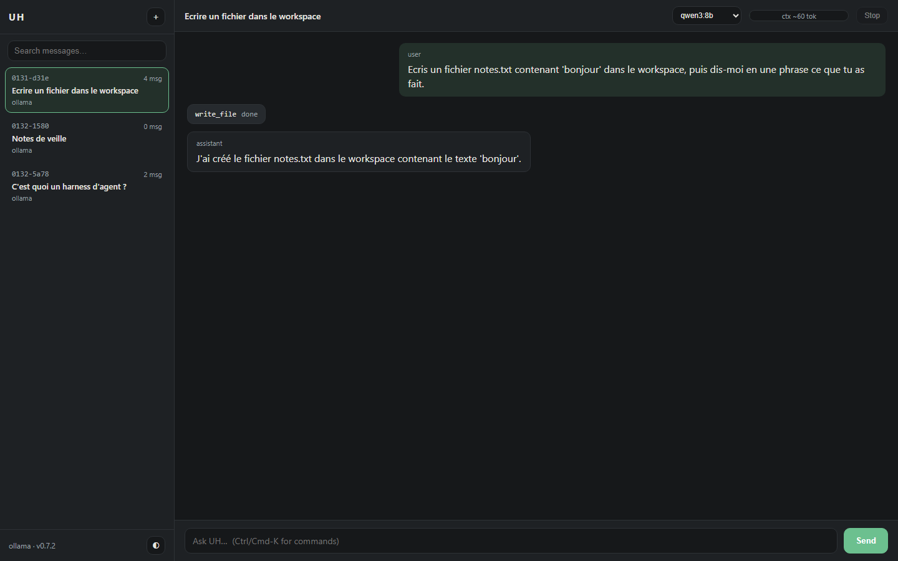

[](https://pypi.org/project/uh-harness/)
[](https://github.com/Antoine-Thomas/UH-Universal-Harness/actions/workflows/publish.yml)

# UH — Universal Harness

A provider-agnostic agent harness in Python: a console, a local web UI, tool use,
persisted sessions, and **one** runtime dependency (`httpx`). Local-first, no
account, no API key on first launch.

## Quickstart

```bash
pip install uh-harness          # Python 3.10+
uh                              # console: picks a local model, starts chatting
pip install "uh-harness[web]" && uh web   # optional: the browser UI
```

That is the whole setup. UH finds an Ollama model you already have, pulls
`qwen2.5:0.5b` automatically when Ollama is running with none installed, falls
back to a local OpenAI-compatible router, and only asks for a key if nothing
local answers — in which case `uh doctor` and the guided setup tell you exactly
what to do. Nothing is sent anywhere until you type a prompt.

## Why UH?

Four ideas that each solved one problem, combined in one small package:

- **A real agent loop, not a chat wrapper** (from Hermes Agent). `run_turn` runs
  synchronously, executes the tools the model asks for, feeds the results back,
  and stops at a hard `max_iterations` budget instead of looping forever.
- **A contract, not a framework** (from OpenClaw). Toolsets declare their
  schema, refuse unknown arguments and return errors the model can read; the
  dangerous toolset is off unless you enable it.
- **Deterministic routing with a traced fallback** (from UHB). Ollama first,
  then Cloudflare, then DeepSeek, then the local gateway and the free router —
  and the fallback is
  *printed*, never silent. A dead provider is an error message, not a mystery.
- **Sessions and a browser UI that stay local** (from Harness Maxxing's feature
  set, reimplemented from scratch). Sessions live in SQLite with full-text
  search; the web UI is served from `127.0.0.1` behind a per-process token.

**The CLI is universal.** UH makes no assumption about a vendor: it drives any
local or free provider (Ollama on `127.0.0.1:11434`, a local router such as
OmniRouter/Nemotron) and never requires an API key on first launch. A paid
provider is an opt-in, never a prerequisite.

- Requires Python ≥ 3.10 (`tomli` is installed automatically on 3.10)
- Single runtime dependency: `httpx` (`[ui]` adds `rich`, `[web]` adds
  `fastapi` + `uvicorn`)
- Installable on its own: no dependency on `hermes-home-vision` or `uhb`
- MIT licence; the web UI is an original implementation (see
  [docs/WEB_DESIGN.md](https://github.com/Antoine-Thomas/UH-Universal-Harness/blob/main/docs/WEB_DESIGN.md))

## Install (development)

```bash
python -m venv .venv
source .venv/bin/activate      # Windows: .venv\Scripts\activate
pip install -e ".[dev]"
uh --version
uh doctor
```

## What 1.0.0 contains

- **Agent core and toolsets.** A synchronous `run_turn` loop, toolsets with
  JSON-schema contracts (`file`, `terminal`, `memory`, `web_search`), a hard
  `max_iterations` budget, `uh chat`.
- **Local model layer and fallback chain.** Streamed chat (`--no-stream` to
  disable), `uh model pull` with progress, providers `ollama`, `cloudflare`,
  `deepseek`, `omnirouter` and the free-provider router. The chain is
  `ollama → cloudflare → deepseek → omnirouter → router`; a provider without a
  key is skipped, every switch is printed on stderr, and `/web <query>` runs a
  search without going through the model.
- **Sessions and configuration.** SQLite FTS5 store (`uh sessions
  list|show|search|delete|resume`), layered configuration (`uh config
  show|get|set|path`), `uh memory migrate|show`, extended `uh doctor`.
- **Console.** Banner, status bar, slash commands (`docs/SLASH_COMMANDS.md`),
  zero-config onboarding (automatic `qwen2.5:0.5b` pull when Ollama is up but
  empty, local router, or a guided free key), `uh providers add|remove` with
  keys in `$UH_HOME/keys.toml` (0600), UTF-8 stdio on Windows.
- **Web UI.** `uh web` serves a local interface (sessions column, streaming
  chat, collapsible tool cards, context gauge, per-session model, full-text
  search, command palette, stop button, light/dark themes) plus an API-key
  panel for Cloudflare, DeepSeek and OmniRoute with masked hints, from three
  static files with no build step and no third-party JavaScript.
- **Free-provider router.** Catalogue verified per entry
  (`uh/router/catalog.toml`), key rotation, cooldowns, circuit breaker,
  tool-capable-model filter, traced failover, opt-in remote access with recorded
  consent and `--local-only`.
- **Local gateway.** `uh router serve`: an OpenAI-compatible endpoint on
  `127.0.0.1` behind its own token, so other tools can use UH's pool, with a
  byte-based body cap, streaming slots and a per-request trace.
- **One service layer.** `uh/providers_admin.py` shared by the console, the CLI
  and the web panel; `docs/API.md` guarded by a drift test.

The web interface is an **original design**: it borrows the feature list of
Harness Maxxing (public README) and none of its code, which is under a Fair
Source Licence. UH stays MIT.

346 tests, 1 skipped locally (Windows, Python 3.11); the CI matrix runs the
suite on Linux, macOS and Windows across Python 3.10 to 3.13.

## Roadmap (after 1.0.0)

- **UHB integration** — plug the second brain (retrieval, wiki, memory) into the
  harness as a toolset, shipped as its own package.
- **Web-session fallback parity** — a browser session currently binds one
  provider; the chain applies to `uh chat` and the console.

## CLI surface

```
uh                      # interactive console (piped: help, unchanged)
uh --version            # print the version
uh doctor               # environment report (python, httpx, git, ollama, store, disk, config, keys)
uh model list           # list models served by Ollama, exit 1 if Ollama is down
uh model pull <name>    # download a model with progress on stderr
uh chat [prompt]        # agent loop with file/terminal/memory tools (streamed, saved)
uh sessions list        # recent sessions (id, date, provider, messages, title)
uh sessions show <id>   # one session and its messages
uh sessions search <q>  # full-text search across every message
uh sessions resume <id> # continue a session (--fork copies it into a new one)
uh config show|get|set  # layered configuration
uh memory migrate|show  # one-shot import of the flat memory file
uh providers list       # registered providers and their state
uh providers add <name> # store a provider (key from a prompt, stdin or UH_PROVIDER_KEY)
uh providers test <name># one 'ping' to a provider, no session content
uh providers remove <name>
uh keys list            # presence and count per provider (values never shown)
uh keys add <name>      # add a key without exposing it
uh keys remove <name> 1 # delete by index, never by value
uh router status        # chain, keys, cooldowns, last error
uh router serve         # OpenAI-compatible endpoint on 127.0.0.1:8780
uh router token show    # the token local clients must use (rotate: token rotate)
uh docs [--open]        # local documentation, no network
uh upgrade [--restart]  # pip install --upgrade uh-harness (--user, --dry-run), then re-exec uh
```

`uh upgrade` reports the running and installed version, refuses to touch a system
interpreter outside a virtualenv unless `--user` is passed, keeps the old version
when pip fails, and only re-execs `uh` when `--restart` is given.

`uh chat` reads stdin or takes a prompt argument; `--once` (or any non-TTY
stdin) answers one line and exits. Answers stream by default, `--no-stream`
waits for the whole message. Conversations are persisted unless `--no-save`;
`--session <id>` resumes (full id, unique prefix, or the short form shown by
`uh sessions list`). Tool activity goes to stderr, the answer to stdout.

## Web interface



*A real session, not a mockup: the assistant called `write_file`, the card is the
tool call, the gauge is the context estimate for that conversation.*

Served locally, never exposed by default:

```
pip install "uh-harness[web]"
uh web                      # http://127.0.0.1:8765/?token=...
uh web --port 9000 --no-open
uh web --allow-terminal     # enable the shell toolset in the browser (off by default)
```

`uh web` without the extra prints the exact install command and exits 1. The
core package stays on `httpx`; `fastapi`/`uvicorn` only exist in `[web]`.

Security, because a local server is still a server:

- binds `127.0.0.1`; any other `--host` prints a warning before starting;
- a 43-character token is generated at startup, accepted once as `?token=` and
  then kept in an `HttpOnly; SameSite=Strict` cookie; every `/api` route answers
  401 without it (curl: send the token as a bearer `Authorization` header);
- `Host` and `Origin` are checked (DNS-rebinding / CSRF), no CORS is enabled;
- strict CSP without `unsafe-inline`, so no inline script or style exists in the
  HTML; `X-Frame-Options: DENY`;
- the **terminal toolset is disabled** unless `--allow-terminal`; file tools stay
  inside `--workspace`;
- no provider key is ever returned by the API.

Design notes and the feature-by-feature rationale live in
[docs/WEB_DESIGN.md](https://github.com/Antoine-Thomas/UH-Universal-Harness/blob/main/docs/WEB_DESIGN.md).

## Use UH from another app (`uh router serve`)

`uh router serve` exposes the chain on loopback, OpenAI-compatible, with its own
token (`uh router token show`). Editors and scripts then use your stored keys
without reconfiguring anything:

```bash
uh router serve --port 8780
export OPENAI_BASE_URL=http://127.0.0.1:8780/v1
export OPENAI_API_KEY="$(cat ~/.uh/router-token)"
```

Details, client examples and the threat model:
[docs/ROUTER_SERVE.md](https://github.com/Antoine-Thomas/UH-Universal-Harness/blob/main/docs/ROUTER_SERVE.md).

## Tools

Every toolset declares an OpenAI-style JSON schema, refuses unknown arguments
and returns errors the model can read — an error is a message, not a crash.

| Toolset | Tools | Notes |
| --- | --- | --- |
| `file` | `read_file`, `write_file`, `list_dir`, `search` | confined to the workspace |
| `terminal` | `run_command` | blacklist plus timeout, not a sandbox; off in the web UI unless `--allow-terminal` |
| `memory` | `memory_read`, `memory_write` | one flat file, sections |
| `web_search` | `web_search(query, max_results)` | DuckDuckGo HTML endpoint, no API key, up to 5 results (title, url, snippet); `max_results` is capped, parse failures are reported as throttling |
| `uhb` | `uhb_status()` | UHB control plane, loopback only (`UH_UHB_URL`, default `http://127.0.0.1:8101`); the toolset exists only when `GET /status` answers within 1 s, and returns version, mode, harness plus provider and mode **names** only |

`/web <query>` runs the search toolset directly from the console, without a
model call and without touching the session history. The toolset returns
`{"error": ...}` on network/HTTP failures and a `note` when the page looks
throttled, so the model (or you) can tell the two apart.

## Console and slash commands

`uh` on a terminal starts the console; piped, it still prints help (scriptable
unchanged). The console opens with the logo (the ASCII art takes over only when
the console encoding cannot carry the box-drawing characters), then a dim header
in three lines: `provider · model · stream`, `workspace · session`, and
`messages · context estimate`. A blank line separates the question from the
answer and precedes every `you>` prompt. `/help` lists everything; the full
inventory and the reason each Hermes command was kept or dropped lives in
[docs/SLASH_COMMANDS.md](https://github.com/Antoine-Thomas/UH-Universal-Harness/blob/main/docs/SLASH_COMMANDS.md).

The release process (Trusted Publishing, TestPyPI then PyPI, yanking) is in [docs/RELEASING.md](https://github.com/Antoine-Thomas/UH-Universal-Harness/blob/main/docs/RELEASING.md).

`/help`, `/model`, `/provider`, `/key`, `/router`, `/local-only`, `/tools`,
`/web`, `/clear`, `/new`, `/sessions`, `/resume`, `/history`, `/retry`,
`/title`, `/save`, `/export`, `/status`, `/config`, `/doctor`, `/memory`,
`/version`, `/exit` (aliases `/h`, `/?`, `/reset`, `/quit`, `/q`, `/v`). An
unknown command is never sent to the model: it is refused with the closest
match suggested.

First run with nothing configured, in order: an installed Ollama model; else,
when Ollama is running with no model, `qwen2.5:0.5b` is pulled automatically
(~400 MB, the smallest tool-capable model); else a local OmniRouter gateway;
else a provider you already added; else a guided setup that explains where to
get a free key and stores it in `$UH_HOME/keys.toml` (0600). UH ships **no
key**: a published key is a stolen key.

The console can use [rich](https://rich.readthedocs.io/) when installed
(`pip install "uh-harness[ui]"`); without it, or off a TTY, everything falls
back to plain text with the same output contract.

```bash
echo "list the python files here" | uh chat --once --model qwen3:8b --workspace .
uh chat --session 1829-9474 "et ensuite ?"           # resume
uh sessions search clavier                            # FTS5 across all messages
uh memory migrate                                     # MEMORY.md -> one session, once
```

## Sessions, store and configuration

- Store: `$UH_HOME/uh.db` (`~/.uh/uh.db`), schema v1, WAL, foreign keys ON.
  Deleting a session cascades to its messages and to the FTS index.
- Two tables (`sessions`, `messages`) plus an external-content FTS5 index kept
  in sync by triggers; `search` returns a snippet and a `bm25` rank.
- A database written by a newer build is refused (`StoreError`), never
  downgraded silently. No FTS5 in the SQLite build means no store at all.
- Configuration, lowest to highest: defaults, `~/.uh/config.toml`, `./uh.toml`,
  `UH_*` environment, CLI flags. `uh config show` prints the source of every
  value. Unknown keys warn and are ignored; the writer handles flat keys only
  (booleans, integers, strings) and refuses anything else.
- `uh memory migrate` copies `MEMORY.md` into a `kind=memory` session after
  writing a timestamped `.bak`; it is idempotent and leaves the flat file in
  place (the memory toolset still reads and writes it).

## Recommended local models (measured, not quoted)

UH has no preferred model, but two are worth knowing for a 8 GB GPU:

| Model | Pull | Context | Tools | Measured in UH |
| --- | --- | --- | --- | --- |
| `qwen3:8b` | 5.2 GB | 32K | yes | slower, better at reasoning |
| `lfm3` | 1.1 GB | 262 144 | yes (native) | `read_file`, `terminal`, `memory_write` all called correctly, ~1.5 s per turn |

`lfm3` (Liquid AI, 1.7B) is the cheap option for tool routing: it emits native
`tool_calls` through Ollama's `/api/chat` (the tag carries `renderer lfm3` /
`parser lfm3`, which is what converts its XML calls into JSON). Requires Ollama
**0.40.13+**; measured here on 0.40.16 with `ollama pull lfm3`.

```bash
ollama pull lfm3
uh chat --model lfm3 --once "combien de lignes fait notes.txt ? utilise read_file"
uh config set default_model lfm3 --user     # optional, applies to new sessions
```

Two honest caveats: its **licence is the LFM Open License v1.0**, not MIT — free
for commercial use below $10M annual revenue, above which you need Liquid's
permission (check it before monetising); and its own model card says it is not
meant for agentic coding or long multi-step reasoning. Use it as a router or an
extractor, keep a bigger model for the rest.

## Providers and fallback

| Provider | Transport | Endpoint | Streaming |
| --- | --- | --- | --- |
| `ollama` | httpx, NDJSON | `POST /api/chat`, `GET /api/tags`, `POST /api/pull` | yes |
| `cloudflare` | httpx, SSE | `POST /v1/chat/completions` (OpenAI-compatible, per-account URL) | yes |
| `deepseek` | httpx, SSE | `POST /chat/completions` (OpenAI-compatible) | yes |
| `omnirouter` | httpx, SSE | `POST /v1/chat/completions` (OpenAI-compatible) | yes |

Without `--provider`, `uh chat` builds the chain `ollama`, then `cloudflare`
(when its account id and token are configured), then `deepseek` (when a key is
configured), then the OmniRoute gateway and the free-provider **router** (when
they are configured). A provider whose key is missing is **skipped**, never
attempted. Every switch is printed on stderr, never silent, and never goes into
the answer:

```
fallback: ollama -> cloudflare (reason: no local model installed)
fallback: cloudflare -> deepseek (reason: 429 rate limit)
```

`--provider <kind>` disables the fallback: one provider, its errors surface as
they are. Model namespaces are not shared, so each backup uses its own model:
`UH_OMNIROUTER_MODEL` (default `auto/best-free`), `deepseek-flash` for DeepSeek,
`@cf/meta/llama-3.3-70b-instruct-fp8-fast` for Cloudflare.

## Free providers, opt-in and local-first

UH ships **no key**: a key in a public package is a stolen key. Instead, `uh
providers free` lists the free, OpenAI-compatible providers (endpoint, free
model ids, documented limits, where to get your own key, and the date each fact
was checked), and stores the key you obtain in `$UH_HOME/keys.toml` (0600 where
the OS allows).

```
uh providers free          # catalogue, then (in a terminal) store a key
uh router status           # per provider: keys, ready/cooling, last error kind
uh --local-only chat ...   # one command, guaranteed local
uh config set allow_remote true
```

Remote access is **off by default**. The first remote call asks for an explicit
consent, because free tiers routinely keep requests and may train on them —
Ollama still answers first whenever a model is installed. Off a terminal, UH
refuses rather than guessing. Multiple keys per provider are rotated, a `429`
parks the key for its `Retry-After`, and three failures open a circuit breaker
that re-probes after a backoff; none of that is silent: the provider and model
that really answered are shown by `uh router status` and stored in the trace.

Catalogue entries carry a verification status and the date they were checked;
the `partial` ones are labelled `UNVERIFIED`, kept out of the automatic chain,
and only used after `uh config set router_extra_providers <name>`. What is verified, what is not, and why no key is ever
shipped: [docs/ROUTER.md](https://github.com/Antoine-Thomas/UH-Universal-Harness/blob/main/docs/ROUTER.md).

## OmniRouter discovery (measured, not guessed)

`uh doctor` and `uh providers list` find a local OmniRoute gateway from these
sources, first hit wins:

1. `UH_OMNIROUTER_URL` (explicit)
2. `OMNIROUTE_BASE_URL` (the OmniRoute CLI's own variable)
3. `BASE_URL=` in `~/.omniroute/.env`
4. `http://{HOST}:{PORT}` from that dotenv (`PORT` defaults to 20128)
5. otherwise: "not configured" - nothing is invented

API key: `UH_OMNIROUTER_API_KEY`, then `OMNIROUTE_API_KEY`, then the same
dotenv. The key is only ever sent as an `Authorization` header, never printed.

What the installed gateway actually looks like (OmniRoute 3.8.52):

- data dir `~/.omniroute`, configuration is a dotenv file plus a SQLite
  database - **no YAML/TOML**, so UH needs no parser dependency;
- server on `http://127.0.0.1:20128`, `GET /v1/models` and
  `POST /v1/chat/completions` answer with a `Bearer` key (1632 model ids on the
  machine this was measured on, including `auto/*` combos);
- streaming is SSE (`data: {...}` chunks, `data: [DONE]` terminator).

## License

MIT — see [LICENSE](https://github.com/Antoine-Thomas/UH-Universal-Harness/blob/main/LICENSE).
