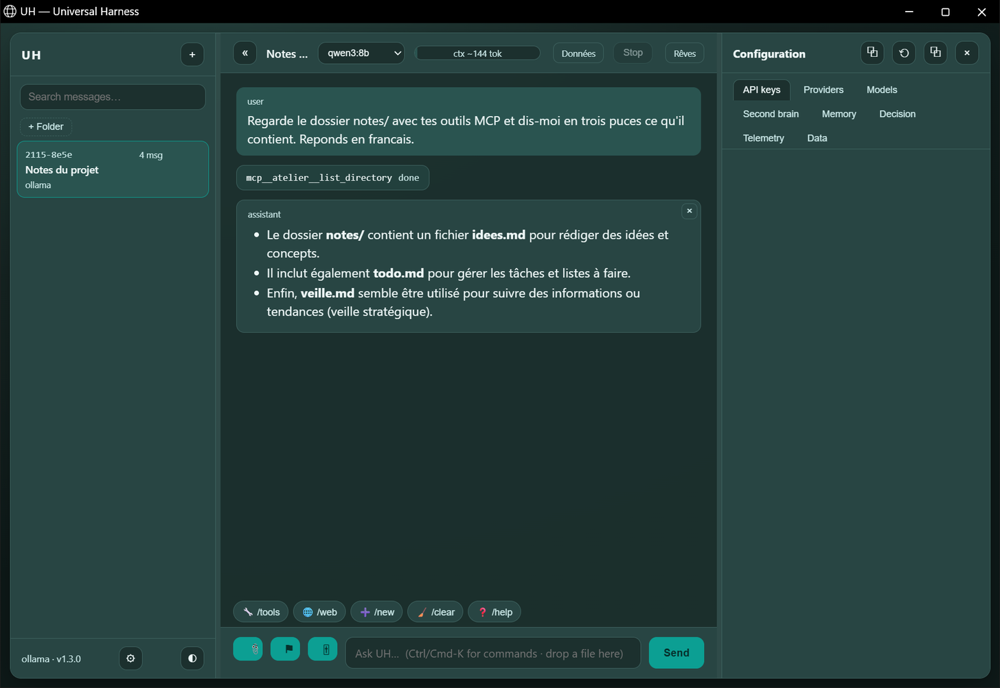

[](https://pypi.org/project/uh-harness/)
[](https://github.com/Antoine-Thomas/UH-Universal-Harness/actions/workflows/ci.yml)
[](LICENSE)
[](https://pypi.org/project/uh-harness/)

# UH — Universal Harness

A provider-agnostic agent harness in Python: a **cockpit** that opens as its own
window, tool use, a **Model Context Protocol client**, a night pass that reads
your notes *and* your tooling, persisted sessions — and **one** runtime
dependency (`httpx`). Local-first: no account, no API key on first launch.



*A real turn, not a mock-up: `qwen3:8b` on the machine that built this, asked to
look at a notes folder, called `mcp__atelier__list_directory` through a
filesystem MCP server, read the three files it returned, and answered in
French. The card is the tool call. Nothing in this screenshot is staged.*

## Quickstart

```bash
pip install uh-harness          # Python 3.10+
uh                              # console: picks a local model, starts chatting
pip install "uh-harness[web]" && uh web   # optional: the browser UI
```

That is the whole setup. UH finds an Ollama model you already have, pulls
`qwen2.5:0.5b` automatically when Ollama is running with none installed, falls
back to a local OpenAI-compatible router, and only asks for a key if nothing
local answers — in which case `uh doctor` and the guided setup tell you exactly
what to do. Nothing is sent anywhere until you type a prompt.

## Why UH?

Four ideas that each solved one problem, combined in one small package:

- **A real agent loop, not a chat wrapper** (from Hermes Agent). `run_turn` runs
  synchronously, executes the tools the model asks for, feeds the results back,
  and stops at a hard `max_iterations` budget instead of looping forever.
- **A contract, not a framework** (from OpenClaw). Toolsets declare their
  schema, refuse unknown arguments and return errors the model can read; the
  dangerous toolset is off unless you enable it.
- **Deterministic routing with a traced fallback** (from UHB). Ollama first,
  then Cloudflare, then DeepSeek, then the local gateway and the free router —
  and the fallback is
  *printed*, never silent. A dead provider is an error message, not a mystery.
- **Sessions and a browser UI that stay local** (from Harness Maxxing's feature
  set, reimplemented from scratch). Sessions live in SQLite with full-text
  search; the web UI is served from `127.0.0.1` behind a per-process token.

**The CLI is universal.** UH makes no assumption about a vendor: it drives any
local or free provider (Ollama on `127.0.0.1:11434`, a local router such as
OmniRouter/Nemotron) and never requires an API key on first launch. A paid
provider is an opt-in, never a prerequisite.

- Requires Python ≥ 3.10 (`tomli` is installed automatically on 3.10)
- Single runtime dependency: `httpx` (`[ui]` adds `rich`, `[web]` adds
  `fastapi` + `uvicorn`)
- Installable on its own: no dependency on `hermes-home-vision` or `uhb`
- MIT licence; the web UI is an original implementation (see
  [docs/WEB_DESIGN.md](https://github.com/Antoine-Thomas/UH-Universal-Harness/blob/main/docs/WEB_DESIGN.md))

## Install (development)

```bash
python -m venv .venv
source .venv/bin/activate      # Windows: .venv\Scripts\activate
pip install -e ".[dev]"
uh --version
uh doctor
```

## Upgrading without breaking the install (Windows)

`uh upgrade` does the whole pass by itself: it stops the other UH processes (they
hold `uh.exe`, which is why `pip` used to answer `WinError 32`), purges pip's
cache, reinstalls with `--force-reinstall --no-cache-dir`, refreshes the Desktop
shortcut, and - when it *is* `uh.exe` - hands the install to a detached console and
leaves first, because Windows will not let a running executable be replaced.

```powershell
uh upgrade            # clean pass, then relaunch the shortcut
uh upgrade --no-clean # plain `pip install --upgrade`, no shortcuts touched
uh upgrade --dry-run  # prints the command, changes nothing
```

When an installation is too broken for `uh upgrade` to run at all (the entry point
itself refuses to start, or `WinError 32` comes back), this is the exact sequence
that repairs it - nothing else is needed:

```powershell
# 1. stop every UH process: they hold uh.exe and the web port
Get-CimInstance Win32_Process |
  Where-Object { $_.Name -eq 'uh.exe' -or $_.CommandLine -like '*-m uh.cli*' } |
  ForEach-Object { Stop-Process -Id $_.ProcessId -Force -ErrorAction SilentlyContinue }

# 2. drop the wheel cache and any half-replaced install
python -m pip cache purge
python -m pip install --force-reinstall --no-cache-dir uh-harness

# 3. rebuild the Desktop shortcut with the current launcher (adds --app, and the
#    step that stops a previous `uh web` before starting a new one)
uh install-shortcut
```

Notes that save an hour:

- **A different interpreter?** `python -m pip` installs for the `python` on your
  `PATH`. Use the same one you launch UH with; `uh --version` and
  `python -c "import uh; print(uh.__file__)"` must point at the same place.
- **`--user`** is only for a user-level install outside a virtualenv.
- **The launcher is a generated file** (`~/.uh/uh-web.ps1`). It carries a version
  line, and `uh web` rewrites it when it is old - a hand-edited launcher is left
  alone, so put your own flags in the shortcut, not in that file.
- **Two versions at once** is the most common "not the right version" report: the
  page is stamped (`?v=…`) and compares itself with `/api/status`, and a busy port
  moves the new server to the next one instead of dying with `exit code 3`.

## What 1.4.0 contains

- **A cockpit, not a chat box.** `uh web` is a three-column window with dockable
  consoles — API keys, providers, models, second brain, memory graph, decision
  trace, telemetry, data hub — each one detachable into its own panel, a layout
  that survives a reload, a command palette, light and dark themes, and a stop
  button that actually stops the stream.
- **A window, not a tab.** `uh web --app` opens that cockpit as a chromeless
  Edge/Chrome window with its own profile under `$UH_HOME/web-app`, and
  `uh install-shortcut` puts one on the Desktop. No Rust toolchain, no
  installer, no signing: one flag and one `.lnk`.
- **MCP client.** `[[mcp.servers]]` in `config.toml` attaches external Model
  Context Protocol servers over stdio; their tools reach the agent loop as
  `mcp__<server>__<tool>`, with a per-server allowlist, caps on the message and
  result sizes, and every failure returned as a tool result instead of a crashed
  turn ([docs/MCP.md](https://github.com/Antoine-Thomas/UH-Universal-Harness/blob/main/docs/MCP.md)).
  The Data panel shows one row per server and a test button that asks it *now*.
- **Cloud connections in two clicks** (no TOML). The Data panel offers "Connecter
  un Cloud": pick **AWS S3** or **Google Drive**, fill the labelled fields, press
  Connect. UH writes the `[[mcp.servers]]` entry for you, keeps the secrets in
  `mcp-secrets.toml` (never in `config.toml`), re-reads the file to prove it
  parses, then shows a green dot once the server has listed its tools. "Exaucer"
  on a dream offers **Exaucer + AWS S3** when a cloud that can write is connected:
  the plan lands in `UH Outputs` *and* in the bucket, and a refusal from the cloud
  is printed next to the plan instead of replacing it
  ([docs/MCP.md](https://github.com/Antoine-Thomas/UH-Universal-Harness/blob/main/docs/MCP.md)).
- **A night pass that knows the tooling.** `uh dream --now` (or the idle daemon,
  or the 03:00 scheduled task) reads SiYuan, the RAG, the installed **skills**
  and the configured **MCP servers**, then proposes ideas *and* workflows that
  name real tools. It never calls one: a 03:00 job that can write through
  somebody else's server with nobody awake is a data-loss story with a cron
  entry. Budgeted in tokens and wall time, written to one folder.
- **Agent core and toolsets.** A synchronous `run_turn` loop, toolsets with
  JSON-schema contracts (`file`, `terminal`, `memory`, `web_search`), a hard
  `max_iterations` budget, `uh chat`.
- **Local model layer and fallback chain.** Streamed chat (`--no-stream` to
  disable), `uh model pull` with progress, providers `ollama`, `cloudflare`,
  `deepseek`, `omnirouter` and the free-provider router. The chain is
  `ollama → cloudflare → deepseek → omnirouter → router`; a provider without a
  key is skipped, every switch is printed on stderr, and `/web <query>` runs a
  search without going through the model (`/web` alone opens the browser UI).
- **Sessions and configuration.** SQLite FTS5 store (`uh sessions
  list|show|search|delete|resume`), layered configuration (`uh config
  show|get|set|path`), `uh memory migrate|show`, extended `uh doctor`.
- **Console.** Banner, status bar, slash commands (`docs/SLASH_COMMANDS.md`),
  zero-config onboarding (automatic `qwen2.5:0.5b` pull when Ollama is up but
  empty, local router, or a guided free key), `uh providers add|remove` with
  keys in `$UH_HOME/keys.toml` (0600), UTF-8 stdio on Windows.
- **Web UI.** `uh web` serves a local interface (sessions column, streaming
  chat, collapsible tool cards, context gauge, per-session model, full-text
  search, command palette, stop button, light/dark themes) plus an API-key
  panel for Cloudflare, DeepSeek and OmniRoute with masked hints, from three
  static files with no build step and no third-party JavaScript.
- **Free-provider router.** Catalogue verified per entry
  (`uh/router/catalog.toml`), key rotation, cooldowns, circuit breaker,
  tool-capable-model filter, traced failover, opt-in remote access with recorded
  consent and `--local-only`.
- **Local gateway.** `uh router serve`: an OpenAI-compatible endpoint on
  `127.0.0.1` behind its own token, so other tools can use UH's pool, with a
  byte-based body cap, streaming slots and a per-request trace.
- **One service layer.** `uh/providers_admin.py` shared by the console, the CLI
  and the web panel; `docs/API.md` guarded by a drift test.

The web interface is an **original design**: it borrows the feature list of
Harness Maxxing (public README) and none of its code, which is under a Fair
Source Licence. UH stays MIT.

1128 tests, 1 skipped locally (Windows and Linux, measured 2026-11-13); the CI
matrix runs the suite on Linux, macOS and Windows across Python 3.10 to 3.13.
The number is a measurement with a date, not a promise: it moves with every
commit that adds a test.

## Roadmap

[docs/ROADMAP_UH_V2.md](https://github.com/Antoine-Thomas/UH-Universal-Harness/blob/main/docs/ROADMAP_UH_V2.md)
is the source of truth for the order of work — phases P0 to P5, each with the
contract that must be true before the next one starts. Two things worth knowing
from it:

- **UHB integration shipped in 1.1.0** (`uhb_status`, `uhb_modes`, `uhb_route`):
  the second brain is a toolset, gated on `GET /modes` answering, loopback only;
- **web-session fallback parity** is still open: a browser session binds one
  provider, while the chain applies to `uh chat` and the console.

## CLI surface

```
uh                      # interactive console (piped: help, unchanged)
uh --version            # print the version
uh doctor               # environment report (python, httpx, git, ollama, store, disk, config, keys)
uh model list           # list models served by Ollama, exit 1 if Ollama is down
uh model pull <name>    # download a model with progress on stderr
uh chat [prompt]        # agent loop with file/terminal/memory tools (streamed, saved)
uh sessions list        # recent sessions (id, date, provider, messages, title)
uh sessions show <id>   # one session and its messages
uh sessions search <q>  # full-text search across every message
uh sessions resume <id> # continue a session (--fork copies it into a new one)
uh config show|get|set  # layered configuration
uh memory migrate|show  # one-shot import of the flat memory file
uh providers list       # registered providers and their state
uh providers add <name> # store a provider (key from a prompt, stdin or UH_PROVIDER_KEY)
uh providers test <name># one 'ping' to a provider, no session content
uh providers remove <name>
uh keys list            # presence and count per provider (values never shown)
uh keys add <name>      # add a key without exposing it
uh keys remove <name> 1 # delete by index, never by value
uh router status        # chain, keys, cooldowns, last error
uh router serve         # OpenAI-compatible endpoint on 127.0.0.1:8780
uh router token show    # the token local clients must use (rotate: token rotate)
uh dream --now           # one read-only night pass: sources, findings, ideas, workflows
uh docs [--open]        # local documentation, no network
uh upgrade [--restart]  # pip install --upgrade uh-harness (--user, --dry-run), then re-exec uh
```

`uh upgrade` reports the running and installed version, refuses to touch a system
interpreter outside a virtualenv unless `--user` is passed, keeps the old version
when pip fails, and only re-execs `uh` when `--restart` is given.

`uh chat` reads stdin or takes a prompt argument; `--once` (or any non-TTY
stdin) answers one line and exits. Answers stream by default, `--no-stream`
waits for the whole message. Conversations are persisted unless `--no-save`;
`--session <id>` resumes (full id, unique prefix, or the short form shown by
`uh sessions list`). Tool activity goes to stderr, the answer to stdout.

## Web interface


*A real session, not a mockup: the assistant called an MCP tool, the card is the
call, the gauge is the context estimate for that conversation.*

Served locally, never exposed by default:

```
pip install "uh-harness[web]"
uh web                      # http://127.0.0.1:8765/?token=...
uh web --app                # ... in its own window (Edge/Chrome --app), no tab bar
uh web --port 9000 --no-open
uh web --allow-terminal     # enable the shell toolset in the browser (off by default)
uh web --no-uhb             # do not start UHB alongside the UI
uh install-shortcut         # Windows: a Desktop shortcut that runs `uh web --app`
```

`uh web --app` finds Edge or Chrome (three install roots each on Windows, `which`
elsewhere, `UH_BROWSER` wins), launches it with `--app=<tokenised URL>`,
`--window-size` and a profile under `$UH_HOME/web-app`, so a browser you already
have open cannot swallow the URL and drop the flag. No Chromium is not an error:
the console says so and a normal tab opens. `uh install-shortcut` already passes
`--app`, which is the difference between a bookmark and an application.

`uh web` starts UHB itself when it can find a checkout — `UH_UHB_URL` for the
address (loopback only), `UH_UHB_PATH` for an unusual folder; the public
`UHB-Universal-Harness-Backend` and `hermes-home-vision/uhb` next to the home
directory are probed otherwise. The child runs without a console window, writes
to `$UH_HOME/uhb.log`, is waited for on `GET /status` (5 s), and is killed with
the UI — including when the window is closed rather than interrupted (a job
object, so the shim's grandchild goes too). A failure is one warning line: the
UI runs, the `uhb` tools are simply absent. Nothing is started if something
already listens on the port.

`uh web` without the extra prints the exact install command and exits 1. The
core package stays on `httpx`; `fastapi`/`uvicorn` only exist in `[web]`.

`uh install-shortcut` is Windows-only and refuses elsewhere with one line. It
writes `uh-web.ps1` and `uh-web.ico` into `$UH_HOME`, then creates `UH web.lnk`
on the Desktop through `WScript.Shell`: no admin rights, no registry key, no
autostart. The icon is generated (zlib PNG in an ICO, standard library) in the
site colours — ink `#284543`, accent `#fdc502` — and the launcher prints its
banner in the same two 24-bit colours, falling back to the nearest console
colours when the terminal refuses virtual-terminal processing.

Security, because a local server is still a server:

- binds `127.0.0.1`; any other `--host` prints a warning before starting;
- a 43-character token is generated at startup, accepted once as `?token=` and
  then kept in an `HttpOnly; SameSite=Strict` cookie; every `/api` route answers
  401 without it (curl: send the token as a bearer `Authorization` header);
- `Host` and `Origin` are checked (DNS-rebinding / CSRF), no CORS is enabled;
- strict CSP without `unsafe-inline`, so no inline script or style exists in the
  HTML; `X-Frame-Options: DENY`;
- the **terminal toolset is disabled** unless `--allow-terminal`; file tools stay
  inside `--workspace`;
- no provider key is ever returned by the API.

Design notes and the feature-by-feature rationale live in
[docs/WEB_DESIGN.md](https://github.com/Antoine-Thomas/UH-Universal-Harness/blob/main/docs/WEB_DESIGN.md).

## Use UH from another app (`uh router serve`)

`uh router serve` exposes the chain on loopback, OpenAI-compatible, with its own
token (`uh router token show`). Editors and scripts then use your stored keys
without reconfiguring anything:

```bash
uh router serve --port 8780
export OPENAI_BASE_URL=http://127.0.0.1:8780/v1
export OPENAI_API_KEY="$(cat ~/.uh/router-token)"
```

Details, client examples and the threat model:
[docs/ROUTER_SERVE.md](https://github.com/Antoine-Thomas/UH-Universal-Harness/blob/main/docs/ROUTER_SERVE.md).

## Tools

Every toolset declares an OpenAI-style JSON schema, refuses unknown arguments
and returns errors the model can read — an error is a message, not a crash.

| Toolset | Tools | Notes |
| --- | --- | --- |
| `file` | `read_file`, `write_file`, `patch`, `search_files`, `read_pdf` | confined to the workspace. `read_pdf(path, pages?)` extracts a PDF's text (50 pages / 10 KB per call, ranges like `2-7`) and is **only offered when `pypdf` is installed** — absent, it simply does not appear in `/tools` |
| `terminal` | `run_command` | blacklist plus timeout, not a sandbox; off in the web UI unless `--allow-terminal` |
| `memory` | `memory_read`, `memory_write` | one flat file, sections |
| `web_search` | `web_search(query, max_results)` | DuckDuckGo HTML endpoint, no API key, up to 5 results (title, url, snippet); `max_results` is capped, parse failures are reported as throttling |
| `uhb` | `uhb_status()`, `uhb_modes()`, `uhb_route(prompt, mode?, complexity?)` | UHB control plane, loopback only (`UH_UHB_URL`, default `http://127.0.0.1:8101`); the toolset exists only when `GET /modes` answers within 1 s, so a UHB older than that contract contributes nothing. `uhb_status` returns version, mode, harness plus provider and mode **names**; `uhb_modes` returns each mode's read/write globs, denied paths and tools; `uhb_route` returns the plan UHB would follow (complexity, reason, ordered failover chain) **without running it** — no token is spent. Errors carry a `kind`: `invalid_request` (400), `unroutable` (409), `configuration` (500), `transport`, `invalid_response` |
| `mcp:<server>` | whatever that server publishes, as `mcp__<server>__<tool>` | one toolset per `[[mcp.servers]]` entry, built only when the server completes the stdio handshake; per-server `allow` list; 10 MB per message, 200 000 characters per result; a failed start is retried after 30 s and contributes no tool meanwhile ([docs/MCP.md](https://github.com/Antoine-Thomas/UH-Universal-Harness/blob/main/docs/MCP.md)) |

`/web <query>` runs the search toolset directly from the console, without a
model call and without touching the session history. The toolset returns
`{"error": ...}` on network/HTTP failures and a `note` when the page looks
throttled, so the model (or you) can tell the two apart.

`/web` with no argument is the other half of the same intent: it serves the web
UI of `uh web` in a background thread, on the session's workspace and on the
same tokenised loopback URL, and the console keeps answering prompts while it
runs. A second `/web` reports the URL already served instead of binding the
port twice; `/exit` (or EOF, or Ctrl+C) stops the server, so no orphan process
keeps port 8765. A missing `[web]` extra, or a busy port, is one line on stderr
— never a traceback.

## Second brain (UHB)

[UHB](https://github.com/Antoine-Thomas/UHB-Universal-Harness-Backend) is the
control plane: it owns the modes (what may be read, written, called) and the
model policy (which model answers, in which order). While it runs, UH gains
three read-only tools — `uhb_status`, `uhb_modes`, `uhb_route` — and none of
them spends a token.

```bash
# terminal 1 - the control plane, default port 8101
cd UHB-Universal-Harness-Backend
python -m uhb.entrypoints.server --port 8101 --mode dev

# terminal 2 - UH, in the project you want to work on
uh
you> which model would UHB use for "refactor the parser"?   # -> uhb_route
```

UH looks for UHB on `http://127.0.0.1:8101` by default. For any other port,
point it there explicitly — in PowerShell:

```powershell
$env:UH_UHB_URL = "http://127.0.0.1:8188"
uh
```

Loopback only: a remote URL is refused, never contacted. The toolset is built
only when `GET /modes` answers within one second — a UHB that is down, or older
than that contract, contributes no tool at all rather than tools that fail when
called.

## Console and slash commands

`uh` on a terminal starts the console; piped, it still prints help (scriptable
unchanged). The console opens with the logo (the ASCII art takes over only when
the console encoding cannot carry the box-drawing characters), then a dim header
in three lines: `provider · model · stream`, `workspace · session`, and
`messages · context estimate`. A blank line separates the question from the
answer and precedes every `you>` prompt. After each turn a dim line reports the
model that **really** answered (a gateway may route `auto/best-free` to a
concrete model) and what it cost:
`omnirouter  qwen3:8b  1234 tok (in 312 / out 922)  total session 3456 tok`.
A provider that reports no counters prints `tokens non rapportés`; `/status`
repeats both numbers. The startup block ends with one discoverable line naming
`uh web`, `uh providers add <name>` and `/help`; `UH_QUIET=1` silences the
banner, the header and that tip (answers, tool activity and metrics stay).
`/help` lists everything; the full
inventory and the reason each Hermes command was kept or dropped lives in
[docs/SLASH_COMMANDS.md](https://github.com/Antoine-Thomas/UH-Universal-Harness/blob/main/docs/SLASH_COMMANDS.md).

The release process (Trusted Publishing, TestPyPI then PyPI, yanking) is in [docs/RELEASING.md](https://github.com/Antoine-Thomas/UH-Universal-Harness/blob/main/docs/RELEASING.md).

`/help`, `/model`, `/provider`, `/key`, `/router`, `/local-only`, `/tools`,
`/web`, `/clear`, `/new`, `/sessions`, `/resume`, `/history`, `/retry`,
`/title`, `/save`, `/export`, `/status`, `/config`, `/doctor`, `/memory`,
`/version`, `/exit` (aliases `/h`, `/?`, `/reset`, `/quit`, `/q`, `/v`). An
unknown command is never sent to the model: it is refused with the closest
match suggested.

First run with nothing configured, in order: an installed Ollama model; else,
when Ollama is running with no model, `qwen2.5:0.5b` is pulled automatically
(~400 MB, the smallest tool-capable model); else a local OmniRouter gateway;
else a provider you already added; else a guided setup that explains where to
get a free key and stores it in `$UH_HOME/keys.toml` (0600). UH ships **no
key**: a published key is a stolen key.

The console can use [rich](https://rich.readthedocs.io/) when installed
(`pip install "uh-harness[ui]"`); without it, or off a TTY, everything falls
back to plain text with the same output contract.

```bash
echo "list the python files here" | uh chat --once --model qwen3:8b --workspace .
uh chat --session 1829-9474 "et ensuite ?"           # resume
uh sessions search clavier                            # FTS5 across all messages
uh memory migrate                                     # MEMORY.md -> one session, once
```

## Where does UH write?

**The workspace is the root.** `uh` starts in, in order of precedence:

1. `--workspace <path>` on the command line;
2. `UH_WORKSPACE`;
3. the current directory — **unless** it is a system directory (`C:\Windows`,
   `C:\Program Files`, `C:\ProgramData`, `/usr`, `/etc`, `/bin`, `/sbin`,
   `/System`, `/Library`), in which case UH uses `~/uh-workspace` (created on
   first use) and says so:

   ```
   [WARN] cwd is a system directory; using ~/uh-workspace instead. Use /workspace <path> to switch.
   ```

**Writes may leave the workspace, but only into declared paths.** Beside the
workspace, these are writable by default:

- `~/Desktop`, `~/Documents`, `~/Downloads`, `~/uh-workspace`.

Add more with `UH_ALLOWED_PATHS` (`os.pathsep`-separated, the supported
persistent switch), or by editing `config.toml` by hand:

```toml
[providers.file]
allowed_paths = ["/srv/partage", "~/projets"]
```

That table is **read-only**: UH's configuration writer is flat (scalars only) on
purpose, so `[providers.file]` is a hand-written escape hatch. `uh config set`
refuses to rewrite a file that contains one rather than silently dropping it.

**System directories are never writable**, whatever the list says: putting
`/etc` in `UH_ALLOWED_PATHS` does not make it a destination.

**Moving during a session.** `/workspace` prints the workspace and the writable
paths; `/workspace <path>` moves the session and the `file`/`terminal` toolsets
(the sandbox follows). `memory` stays in `$UH_HOME`: `MEMORY.md` is UH's own
state, not project data.

**Refusals say what to do.** A refused write carries the list and the two exits:

```
refused: '~/secret.txt' is outside the workspace and outside the allowed paths
(~/Desktop, ~/Documents, ~/Downloads, ~/uh-workspace). Use /workspace <path> to
switch. (hint: /workspace <path> or `uh --workspace <path>`)
```

**The shell is a seatbelt, not a sandbox.** `terminal` checks the obvious write
shapes (`>`, `>>`, `mkdir`, `md`, `touch`, `tee`, and the destination of
`cp`/`copy`/`mv`/`move`/`install`/`ln`) against the same rule before spawning
anything. A program that writes on its own — `python -c "open(...)"`, a script
the model creates and runs, an editor, `cmd /c` — still goes through. The file
toolset is the enforced path; the shell guard stops accidents, not a determined
author.

Use **absolute paths** in a shell command: `cmd.exe` does not expand `~` (a
POSIX shell does), so `> ~/Desktop/x` passes the guard and then fails in the
shell. The file toolset expands `~`; in the terminal, write the resolved path or
use `%USERPROFILE%`.

## Sessions, store and configuration

- Store: `$UH_HOME/uh.db` (`~/.uh/uh.db`), schema v1, WAL, foreign keys ON.
  Deleting a session cascades to its messages and to the FTS index.
- Two tables (`sessions`, `messages`) plus an external-content FTS5 index kept
  in sync by triggers; `search` returns a snippet and a `bm25` rank.
- A database written by a newer build is refused (`StoreError`), never
  downgraded silently. No FTS5 in the SQLite build means no store at all.
- Configuration, lowest to highest: defaults, `~/.uh/config.toml`, `./uh.toml`,
  `UH_*` environment, CLI flags. `uh config show` prints the source of every
  value. Unknown keys warn and are ignored; the writer handles flat keys only
  (booleans, integers, strings) and refuses anything else.
- `uh memory migrate` copies `MEMORY.md` into a `kind=memory` session after
  writing a timestamped `.bak`; it is idempotent and leaves the flat file in
  place (the memory toolset still reads and writes it).

## Recommended local models (measured, not quoted)

UH has no preferred model, but two are worth knowing for a 8 GB GPU:

| Model | Pull | Context | Tools | Measured in UH |
| --- | --- | --- | --- | --- |
| `qwen3:8b` | 5.2 GB | 32K | yes | slower, better at reasoning |
| `lfm3` | 1.1 GB | 262 144 | yes (native) | `read_file`, `terminal`, `memory_write` all called correctly, ~1.5 s per turn |

`lfm3` (Liquid AI, 1.7B) is the cheap option for tool routing: it emits native
`tool_calls` through Ollama's `/api/chat` (the tag carries `renderer lfm3` /
`parser lfm3`, which is what converts its XML calls into JSON). Requires Ollama
**0.40.13+**; measured here on 0.40.16 with `ollama pull lfm3`.

```bash
ollama pull lfm3
uh chat --model lfm3 --once "combien de lignes fait notes.txt ? utilise read_file"
uh config set default_model lfm3 --user     # optional, applies to new sessions
```

Two honest caveats: its **licence is the LFM Open License v1.0**, not MIT — free
for commercial use below $10M annual revenue, above which you need Liquid's
permission (check it before monetising); and its own model card says it is not
meant for agentic coding or long multi-step reasoning. Use it as a router or an
extractor, keep a bigger model for the rest.

## Popular providers

UH ships with Ollama, OmniRoute, Cloudflare and DeepSeek natively. Any
OpenAI-compatible provider can be added in one command:

| Provider | Base URL | Example model |
| --- | --- | --- |
| OpenAI | `https://api.openai.com/v1` | `gpt-4o-mini` |
| Mistral | `https://api.mistral.ai/v1` | `mistral-small-latest` |
| Kimi (Moonshot) | `https://api.moonshot.ai/v1` | `kimi-k2` |
| Google Gemini | `https://generativelanguage.googleapis.com/v1beta/openai/` | `gemini-2.0-flash` |
| Groq | `https://api.groq.com/openai/v1` | `llama-3.3-70b-versatile` |
| Together | `https://api.together.xyz/v1` | `meta-llama/Llama-3.3-70B-Instruct-Turbo` |

```bash
uh providers add openai --base-url https://api.openai.com/v1 --model gpt-4o-mini
# then paste your key when prompted (it is stored in $UH_HOME/keys.toml, 0600)
```

Claude is not natively OpenAI-compatible: point UH at a gateway (LiteLLM,
OpenRouter, or OmniRoute) that exposes `/v1/chat/completions`.

The `uh web` panel has the same presets behind a dropdown in its **API keys**
tab: picking one fills the base URL and the default model, you paste the key
and save.

## Providers and fallback

| Provider | Transport | Endpoint | Streaming |
| --- | --- | --- | --- |
| `ollama` | httpx, NDJSON | `POST /api/chat`, `GET /api/tags`, `POST /api/pull` | yes |
| `cloudflare` | httpx, SSE | `POST /v1/chat/completions` (OpenAI-compatible, per-account URL) | yes |
| `deepseek` | httpx, SSE | `POST /chat/completions` (OpenAI-compatible) | yes |
| `omnirouter` | httpx, SSE | `POST /v1/chat/completions` (OpenAI-compatible) | yes |

Without `--provider`, `uh chat` builds the chain `ollama`, then `cloudflare`
(when its account id and token are configured), then `deepseek` (when a key is
configured), then the OmniRoute gateway and the free-provider **router** (when
they are configured). A provider whose key is missing is **skipped**, never
attempted. Every switch is printed on stderr, never silent, and never goes into
the answer:

```
fallback: ollama -> cloudflare (reason: no local model installed)
fallback: cloudflare -> deepseek (reason: 429 rate limit)
```

`--provider <kind>` disables the fallback: one provider, its errors surface as
they are. Model namespaces are not shared, so each backup uses its own model:
`UH_OMNIROUTER_MODEL` (default `auto/best-free`), `deepseek-flash` for DeepSeek,
`@cf/meta/llama-3.3-70b-instruct-fp8-fast` for Cloudflare.

## Free providers, opt-in and local-first

UH ships **no key**: a key in a public package is a stolen key. Instead, `uh
providers free` lists the free, OpenAI-compatible providers (endpoint, free
model ids, documented limits, where to get your own key, and the date each fact
was checked), and stores the key you obtain in `$UH_HOME/keys.toml` (0600 where
the OS allows).

```
uh providers free          # catalogue, then (in a terminal) store a key
uh router status           # per provider: keys, ready/cooling, last error kind
uh --local-only chat ...   # one command, guaranteed local
uh config set allow_remote true
```

Remote access is **off by default**. The first remote call asks for an explicit
consent, because free tiers routinely keep requests and may train on them —
Ollama still answers first whenever a model is installed. Off a terminal, UH
refuses rather than guessing. Multiple keys per provider are rotated, a `429`
parks the key for its `Retry-After`, and three failures open a circuit breaker
that re-probes after a backoff; none of that is silent: the provider and model
that really answered are shown by `uh router status` and stored in the trace.

Catalogue entries carry a verification status and the date they were checked;
the `partial` ones are labelled `UNVERIFIED`, kept out of the automatic chain,
and only used after `uh config set router_extra_providers <name>`. What is verified, what is not, and why no key is ever
shipped: [docs/ROUTER.md](https://github.com/Antoine-Thomas/UH-Universal-Harness/blob/main/docs/ROUTER.md).

## OmniRouter discovery (measured, not guessed)

`uh doctor` and `uh providers list` find a local OmniRoute gateway from these
sources, first hit wins:

1. `UH_OMNIROUTER_URL` (explicit)
2. `OMNIROUTE_BASE_URL` (the OmniRoute CLI's own variable)
3. `BASE_URL=` in `~/.omniroute/.env`
4. `http://{HOST}:{PORT}` from that dotenv (`PORT` defaults to 20128)
5. otherwise: "not configured" - nothing is invented

API key: `UH_OMNIROUTER_API_KEY`, then `OMNIROUTE_API_KEY`, then the same
dotenv. The key is only ever sent as an `Authorization` header, never printed.

What the installed gateway actually looks like (OmniRoute 3.8.52):

- data dir `~/.omniroute`, configuration is a dotenv file plus a SQLite
  database - **no YAML/TOML**, so UH needs no parser dependency;
- server on `http://127.0.0.1:20128`, `GET /v1/models` and
  `POST /v1/chat/completions` answer with a `Bearer` key (1632 model ids on the
  machine this was measured on, including `auto/*` combos);
- streaming is SSE (`data: {...}` chunks, `data: [DONE]` terminator).

## License

MIT — see [LICENSE](https://github.com/Antoine-Thomas/UH-Universal-Harness/blob/main/LICENSE).

## Name disambiguation

`uh-harness` is an independent, MIT-licensed agent harness: a local-first
console and desktop-style cockpit, one runtime dependency, no account.
It is **not affiliated with** the `universal-harness` package on PyPI (a
different project, different author, AGPL-3.0), and nothing here shares code,
data or infrastructure with it. The import name is `uh`, the command is `uh`,
the repository is `Antoine-Thomas/UH-Universal-Harness`.

If you are comparing the two: UH is a local cockpit (chat, memory graph,
telemetry, backups, skills) whose state lives in files under `~/.uh` that you can
read, zip and restore without any service. The other project is a governance
layer for a hosted agent ecosystem. Same word "harness", two different jobs -
installing one does not install the other.

```bash
pip install uh-harness      # what this repository publishes
```
