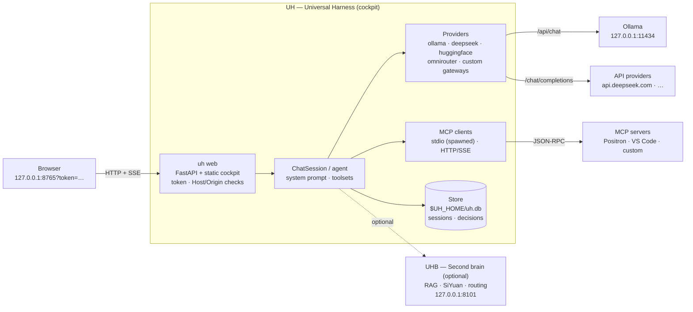

# Architecture

Two processes on one machine, one of them optional. Nothing in UH requires an
account, and every connection is loopback unless the user explicitly says otherwise.



## The three rings

| Ring | What it is | Can it leave the machine? |
| --- | --- | --- |
| **UH** | the cockpit: the chat, the interface, the MCP clients, the tools | the interface never does; a provider call does, only to the provider you configured |
| **Local models** | Ollama on `127.0.0.1:11434`, or a TGI server on loopback | no |
| **UHB** (optional) | RAG, the SiYuan knowledge base, model routing | no: `127.0.0.1:8101` |

UH works with UHB absent: the second brain is a backend it *can* talk to, not a
dependency. A missing UHB is a missing feature, never a broken start.

## One chat turn

```mermaid
sequenceDiagram
    participant U as User
    participant W as uh web
    participant A as Agent
    participant P as Provider
    participant M as MCP server

    U->>W: message (token, same-origin proof)
    W->>A: run_text
    A->>P: chat (stream)
    P-->>A: tokens …
    A-->>W: SSE token frames
    A->>M: tools/call
    Note over A,M: remote server ⇒ an approval frame first;<br/>no answer is a refusal
    M-->>A: result
    A->>A: record the decision (model, latency, tokens, tools)
    A-->>W: answer frame
    W-->>U: rendered answer
```

A local stdio server runs inside the turn. A remote HTTP/SSE server never executes
without a per-call approval, and an unanswered ticket counts as a refusal.

## Where the state lives

| File | Holds | Never holds |
| --- | --- | --- |
| `$UH_HOME/config.toml` | defaults: provider, model, workspace, limits | a key, a token |
| `$UH_HOME/keys.toml` (owner-only) | API keys and custom gateways | anything shown in the UI |
| `$UH_HOME/mcp-secrets.toml` (owner-only) | MCP tokens | anything returned by an API |
| `$UH_HOME/uh.db` | sessions, decisions, memory | — |

`config.toml` is the file people paste into issues; a secret never enters it. Every
route that describes a stored key returns a mask (`••••` + 4 characters) and nothing
else.

## The interface rule

Each subject has exactly one door, and the doors do not move:

| Tab | For | Not for |
| --- | --- | --- |
| `Fournisseurs` (`?panel=keys`) | model keys, gateways, cloning a working setup | a storage account |
| `IA locale` (`?panel=local`) | detecting or installing a local model | a credential |
| `Connexions` (`?panel=conn`) | cloud storage (S3, Google Drive) **and** MCP servers (Positron, VS Code) | a model key |
| `Données` (`?panel=data`) | backup, skills, installed tools, repair UH | **any connection** |

The system prompt carries the same table, so the agent sends people to the right
tab instead of describing a file edit. `SYSTEM_MAP.md` adds the paths and this
architecture on every turn.

## Why the model switch is a pair

A model id means nothing without the provider that serves it: `lfm3:latest` only
exists on Ollama, `deepseek-v4-pro` only on DeepSeek. The header therefore switches
`(provider, model)` together, refuses a contradictory pair with a sentence, and
shows which engine is answering. `POST /api/model` accepts a bare id only when a
catalogue can name its provider unambiguously.
