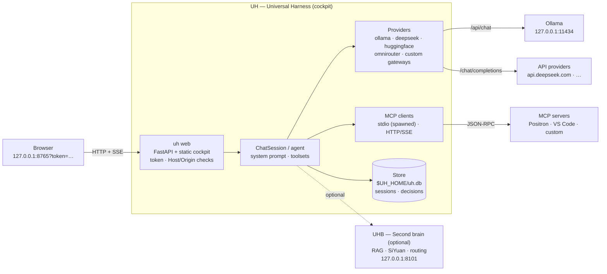

# Architecture

Two processes on one machine, one of them optional. Nothing in UH requires an
account, and every connection is loopback unless the user explicitly says otherwise.



## The three rings

| Ring | What it is | Can it leave the machine? |
| --- | --- | --- |
| **UH** | the cockpit: the chat, the interface, the MCP clients, the tools | the interface never does; a provider call does, only to the provider you configured |
| **Local models** | Ollama on `127.0.0.1:11434`, or a TGI server on loopback | no |
| **UHB** (optional) | RAG, the SiYuan knowledge base, model routing | no: `127.0.0.1:8101` |

UH works with UHB absent: the second brain is a backend it *can* talk to, not a
dependency. A missing UHB is a missing feature, never a broken start.

## One chat turn

```mermaid
sequenceDiagram
    participant U as User
    participant W as uh web
    participant A as Agent
    participant P as Provider
    participant M as MCP server

    U->>W: message (token, same-origin proof)
    W->>A: run_text
    A->>P: chat (stream)
    P-->>A: tokens …
    A-->>W: SSE token frames
    A->>M: tools/call
    Note over A,M: remote server ⇒ an approval frame first;<br/>no answer is a refusal
    M-->>A: result
    A->>A: record the decision (model, latency, tokens, tools)
    A-->>W: answer frame
    W-->>U: rendered answer
```

A local stdio server runs inside the turn. A remote HTTP/SSE server never executes
without a per-call approval, and an unanswered ticket counts as a refusal.

Since P1-14, the same turn also carries files - and they change nothing about the
shape above:

```
message + attachments
  → attachments.compose()      text, with each file described (inlined if small)
  → attachments.media_for()    prepared copies: -sent.jpg under 1 MB, or keyframes
  → run_turn(images=[…])       bytes on the REQUEST copy, shaped per wire, never stored
  → console / app              the same frames, plus answer_meta at the end
  → purge                      derived/ disappears, except what « Garder » marked
```

`media_for()` samples a batch beyond 12 images and says so in the message rather than
refusing it, and `run_text` drops the bytes entirely when the capability table says the
model is blind - Ollama answers 400 "Multimodal data provided, but model does not
support multimodal requests", which used to cost the whole turn.

## Where the state lives

| File | Holds | Never holds |
| --- | --- | --- |
| `$UH_HOME/config.toml` | defaults: provider, model, workspace, limits | a key, a token |
| `$UH_HOME/keys.toml` (owner-only) | API keys and custom gateways | anything shown in the UI |
| `$UH_HOME/mcp-secrets.toml` (owner-only) | MCP tokens | anything returned by an API |
| `$UH_HOME/uh.db` | sessions, decisions, memory | base64 audio or images |
| `$UH_HOME/uploads/<session>/` | the files the operator chose, plus `derived/` (prepared copies) | anything the turn did not produce |
| `$UH_HOME/memory/` | what was kept, in canonical format (PNG lossless, FLAC 24-bit stereo) | a pointer to a run that retention may delete |
| `$UH_HOME/artifact-ratings.jsonl` | one line per vote, `none` included | a secret |

`config.toml` is the file people paste into issues; a secret never enters it. Every
route that describes a stored key returns a mask (`••••` + 4 characters) and nothing
else.

## The frame contract (every type, both ends)

`uh/console.py` and `uh/web/app.py` emit; `uh/web/static/app.js` consumes. A test
(`tests/test_wiring_audit.py`) reads both files and refuses a frame with only one end.

| Frame | Emitted by | What the page does |
| --- | --- | --- |
| `open` | `app.py` chat route | takes the turn: clears the composer, starts the watchdog |
| `ping` | `app.py` (heartbeat) | life sign, nothing rendered |
| `token` | `console._emit` / slash command | appends to the answer bubble |
| `answer` | `console._emit` / slash command | fills the bubble **only if** no token arrived |
| `answer_meta` | `app.answer_meta()` | one model value: footer, header tooltip, local-model tab |
| `tool_call` | `console._emit` | opens a tool card |
| `tool_result` | `console._emit` | fills it, draws artifacts |
| `artifacts` | `console._emit` | draws images from the bounded data URLs |
| `approval` | `mcp_http.notify` | the approval card; no card, no call |
| `notice` | `console` end-of-turn notices | a system line, stored too (point 1) |
| `mode_refused` | `mode_gate.mode_refused_frame()` | the « Autoriser pour cette conversation » card |
| `error` | `app.py` / `console` | a failed bubble, never a silent turn |
| `done` | `app.py` | closes the turn, reconciles the view with SQLite |

## The four locks, and where each one lives

| Lock | Lives in | Test that holds it |
| --- | --- | --- |
| a mode that decides what is offered | `uh/mode_gate.py` + `console._intent_toolsets` | `tests/test_mode_gate.py` |
| a mode switch only this machine can perform | `app.py` middleware (Host/Origin/Sec-Fetch-Site) + `is_loopback_bind` + token | `tests/test_uhb_mode_guard.py` |
| a confined atelier interpreter | UHB `uhb/tools/execute.py` (`sys.addaudithook`) | UHB `uhb/tests` |
| audio and media that cannot reach the turn | package boundaries (`uh/audio`, `uh/media` imported inside handlers only) | `tests/test_audio_chain.py`, `tests/test_wiring_audit.py` |

The last row is the architectural one: `uh/agent.py` and `uh/providers/*` contain no
import of either package, measured in a clean process (`sys.modules`), so a broken
engine, an absent key or a missing codec can never cost a text answer.

## Audio and media sit beside the turn, not inside it

- **routes**: `/api/audio/*` (capabilities, transcribe, speak, file) and
  `/api/media/capabilities` are the only doors; the chat route never calls an engine.
- **what a turn receives**: prepared image copies under 1 MB (`-sent.jpg`), keyframes
  instead of a video, and text for everything else. The bytes ride on the *request*
  copy of the history (`_images`), are shaped per wire, and never reach SQLite.
- **capability is measured**: `uh/capabilities.py` asks the provider (Ollama
  `/api/show`, a gateway's `input_modalities`, Mistral's `capabilities.vision`).
  Unknown is not capable, and the composer says what will be lost before sending.
- **what survives a turn**: the originals, plus the prepared copy of anything marked
  « Garder » (the purge reads the sidecar each copy carries).
- **what is remembered**: `uh/memory.py` copies a kept file into a canonical format -
  PNG lossless at its resolution, FLAC 24-bit stereo - indexed by SHA-256 and tied to
  its message. Emptying the bin forgets the entries its files carried.
- **what cleans up**: `uh/maintenance.py` sweeps prepared copies and stale uploads,
  and reports orphans in both directions instead of deleting something a message
  still mentions.

## The interface rule

Each subject has exactly one door, and the doors do not move:

| Tab | For | Not for |
| --- | --- | --- |
| `Fournisseurs` (`?panel=keys`) | model keys, gateways, cloning a working setup | a storage account |
| `IA locale` (`?panel=local`) | detecting or installing a local model | a credential |
| `Connexions` (`?panel=conn`) | cloud storage (S3, Google Drive) **and** MCP servers (Positron, VS Code) | a model key |
| `Données` (`?panel=data`) | backup, skills, installed tools, repair UH | **any connection** |

The system prompt carries the same table, so the agent sends people to the right
tab instead of describing a file edit. `SYSTEM_MAP.md` adds the paths and this
architecture on every turn.

## Why the model switch is a pair

A model id means nothing without the provider that serves it: `lfm3:latest` only
exists on Ollama, `deepseek-v4-pro` only on DeepSeek. The header therefore switches
`(provider, model)` together, refuses a contradictory pair with a sentence, and
shows which engine is answering. `POST /api/model` accepts a bare id only when a
catalogue can name its provider unambiguously.

## The turn's context never lives on the application

`app.state` belongs to the process, not to a session nor to a turn. The workspace and the
readable upload roots of a turn are therefore **parameters** of `_toolsets(app, *, workspace,
read_roots, ...)`, held in the variables of the thread that runs the turn, and never stored as
`app.state.turn_*`. The previous shape was measured leaking: two concurrent turns overwrote the
same attribute and the first one inherited the second one's upload roots, i.e. read access to
another session's attachments. `tests/test_turn_isolation.py` forces the interleaving with a
barrier and failed with "A received the context of session-b" before the fix.

Consequence for any new per-turn value: pass it down, do not hang it on the application. A test
that stubs `_toolsets` must accept the same keywords.
