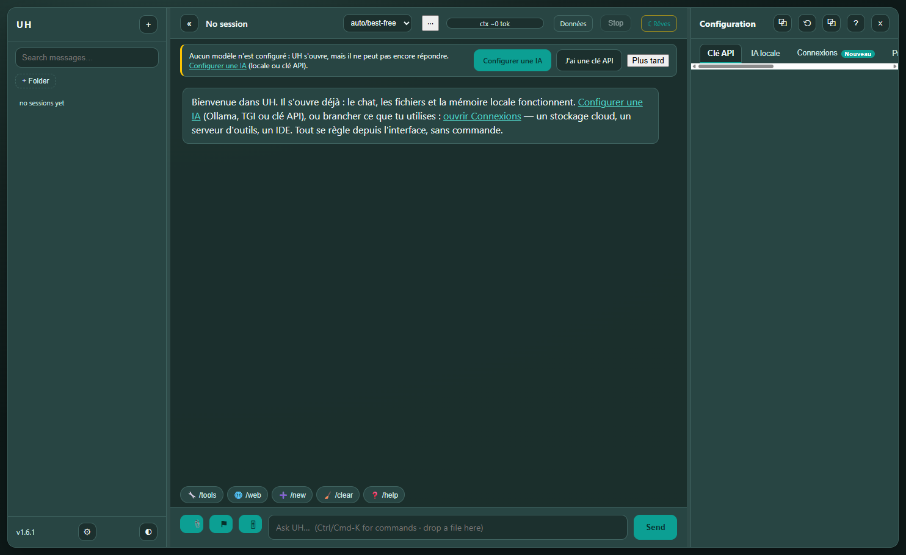
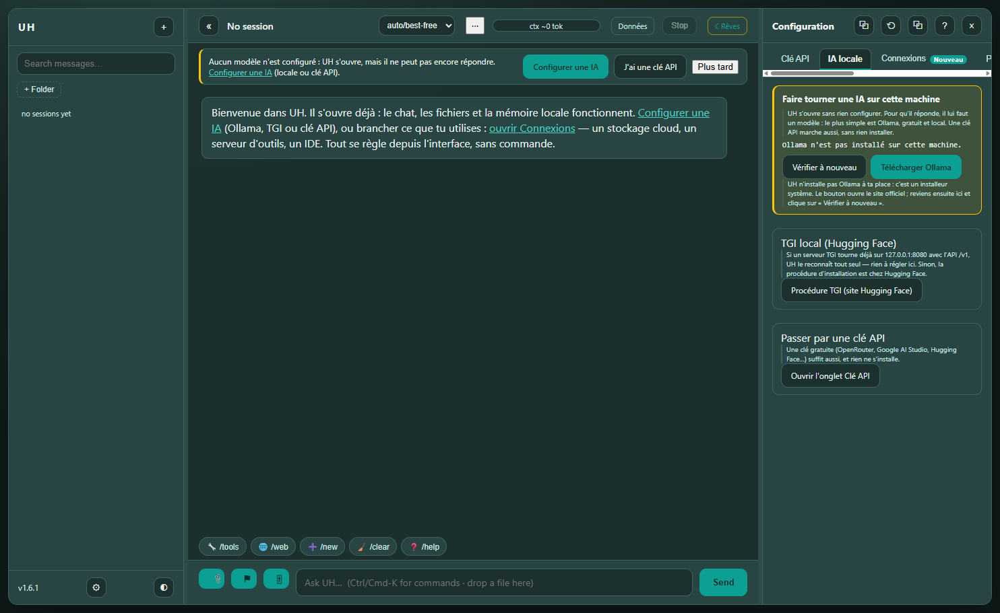
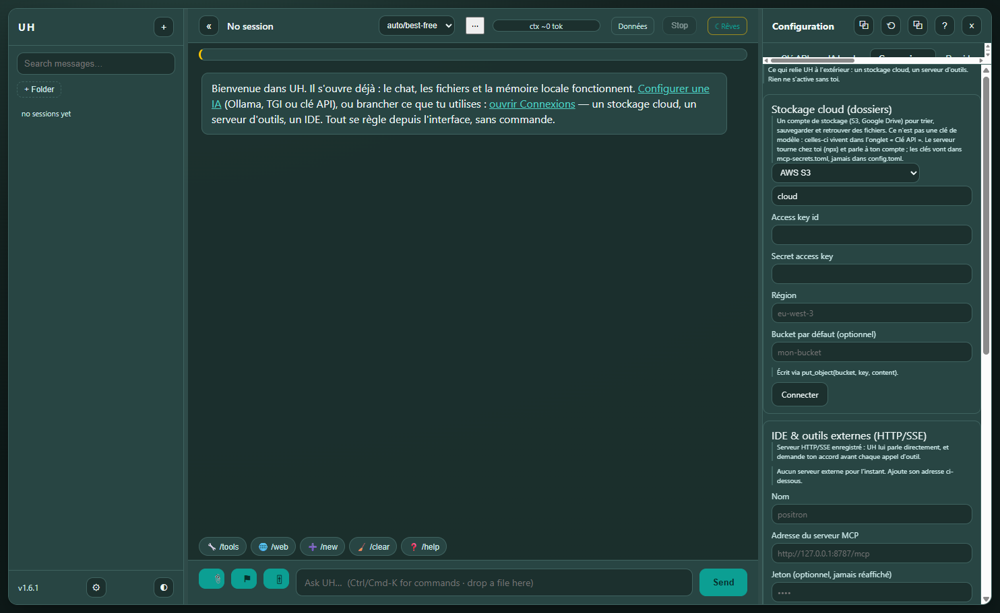

# UX rules the cockpit follows

Three rules, each with the screen that shows it. Every screenshot is a real
cockpit driven over DevTools (`scripts/prove_ui_cdp.py`), on a disposable
`UH_HOME` with no provider.

## 1. The first launch is an invitation, not a wall

The chat opens before any model exists. A discreet banner offers the next step
(`Configurer une IA`, `J'ai une clé API`, `Plus tard`), and `Plus tard` is
remembered. No modal, nothing blocked: the files, the memory and the sessions
work already.

A model that is already on the machine (Ollama, a TGI on `127.0.0.1:8080`) is
found on its own - `provider: ollama · model: qwen3:8b` in the startup line.

## 2. "IA locale" is a guide, not a setting

The yellow panel says what is true now (absent / installed but stopped / running
with N models), links to the official Ollama installer, and **installs nothing**:
UH is a Python package, not a system installer. Once Ollama answers, one button
picks the model. A TGI is detected, never launched. The key route stays one click
away, in the `Clé API` tab.

## 3. Keys, connections and storage are three different things

| Tab | What lives there | What it is not |
| --- | --- | --- |
| `Clé API` | LLM credentials (OpenRouter, DeepSeek, Hugging Face…) | not a storage account |
| `IA locale` | how to run a model on this machine | not a credential store |
| `Connexions` | cloud **storage** (S3, Google Drive: sort, sync, back up folders), MCP servers, IDEs | not an LLM key |

The three first tabs are the ones visible without scrolling; everything else comes
after. A deep link reaches any of them: `/?panel=keys`, `/?panel=local`,
`/?panel=conn`.
